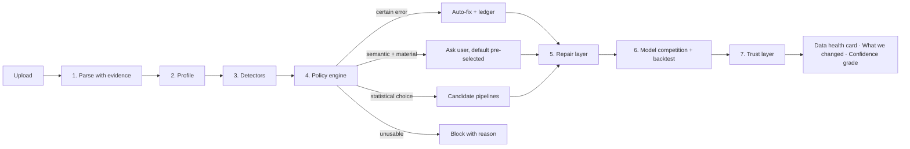

# Data Health: Design for Trustworthy Forecasts on Imperfect Data

Status: proposal · Branch: `feature/enterprise-ui` · Date: 2026-11-21

## 1. Problem

DemandSense currently treats every upload the same way: parse, sum duplicate
dates, interpolate gaps, cap outliers with a global IQR rule, then train. Every
one of those steps changes the data **silently**. The preprocessing report that
records them is written only to the server log and never reaches the user.

Two failure modes follow, and they pull in opposite directions:

1. **Silent corruption.** The pipeline "fixes" things that were not broken
   (seasonal peaks, zero-sales days) and misreads things it should have
   questioned (date order, number formats). The forecast looks confident and is
   wrong.
2. **Alarm fatigue.** The naive remedy, flagging every irregularity, makes a
   clean-enough dataset look broken and teaches users to ignore warnings.

The goal is the thin line between them: **fix what is certain, ask only what is
ambiguous *and* matters, warn only when it changes the forecast, block only what
is unusable.**

## 2. Evidence: what goes wrong today

All findings below were reproduced against the current backend code
(`services/preprocessor.py`, `routers/upload.py`, `services/model_runner.py`)
using crafted inputs. The probe and experiment scripts are in
`backend/benchmarks/data_health/`.

### 2.1 Parsing and structure faults (deterministic, reproduced)

| # | Fault | Input | What the pipeline does today | Warned? |
|---|---|---|---|---|
| P1 | US thousands separators | `"1,234"`, `"2,500"` | Parsed as European decimals → **1.234, 2.5** (1000× too small) | No |
| P2 | Day-first dates, day ≤ 12 | Monthly `01/03/2021` … | Read month-first → **36 months collapse into one January** | No |
| P3 | Business-day data | Mon–Fri with 5 holidays absent | Frequency inferred as daily → **159 weekend days invented** (29% of series) | No |
| P4 | One typo date | `2032-07-20` in a 2023 file | **3,124 days invented** by interpolation (90% of the series) | No |
| P5 | Level metric with duplicate timestamps | Two sensors per day, ~22 °C | Summed → **44 °C** | No |
| P6 | Rows exported twice | One month duplicated | That month doubled, then partly capped | No |
| P7 | Real seasonal peak | December ×3 | Global IQR caps **297 → 140**; the peak is erased | No |
| P8 | Missing days in sales data | 21 no-sale days (your `retail_sales_dataset`) | Interpolated → **~7 units invented per day** | No |
| P9 | Blank target on a duplicated date | `Sales = ""` twice on one date | Becomes **0**, while the warning says "treated as missing" | Misleading |
| P10 | Daylight-saving fall-back | Hourly data, repeated 01:00 | Summed → **false 2× spike** | No |
| P11 | Target-name keyword match | `Paid_Amount`, `Holiday_Sales`, `Turkey_Sales`, `Liquid_Litres` | Substring match on `id`/`key`/`lat` → **hidden from the target list** | No |
| P12 | Hard upload errors | No date column / no numeric column | Returned as `validation.errors`, **never displayed** by the UI | No |
| P13 | Dead code | Hourly smoothing step | Checks `freq == "H"`, pandas 3 emits `"h"` → never runs | — |

### 2.2 Accuracy impact of statistical faults (end-to-end, reproduced)

Each scenario runs the real pipeline (preprocess → 16 models → selection) on a
synthetic daily series whose true next 28 days are known. "As-is" is today's
behaviour; "fixed" applies the correct handling. MASE against the true future,
lower is better.

Bias is total forecast volume vs true volume over the 28 days. The "flat mean"
column is a plain average of the last 8 weeks, for reference.

| Scenario | As-is MASE (bias) | Fixed MASE (bias) | Flat mean | Verdict |
|---|---|---|---|---|
| A. Clean data (reference) | 0.68 (−3%) | — | 0.96 | Pipeline works well on clean data |
| D. Stockout zeros (3 × 10-day runs) | 0.70 (−5%) | **0.64 (+4%)** masked as missing | 0.94 | Fix helps (9% lower error) |
| G. One month exported twice | 0.82 (+5%) | **0.60 (+3%)** exact duplicates dropped | 0.90 | Fix helps a lot (26% lower error) |
| H. No learnable pattern | 0.68 (**+21%**) | — | **0.62** | Selected model is **worse than a flat mean** and over-forecasts by a fifth |
| C. December peak ×2.6, forecasting December | 10.1 (**−64%**) | 10.2 (−64%) without capping | 9.8 | **Selection blind spot**, see below |
| E. Level drop −40%, 120 days before end | 0.68 (−5%) | 0.74 (−9%) trained after break only | 0.68 | The "obvious" fix made it **worse** |
| F. Last day only 25% recorded | 0.97 (+2%) | 0.99 (+3%) partial day dropped | 1.22 | No material effect |
| B. No-sale days absent (low volume) | 0.70 (−22%) | 0.75 (−30%) zero-filled | 0.74 | No accuracy gain; bias comes from model choice |

**The December finding.** With capping switched off, three models forecast
December almost exactly: MSTL 211/day, XGBoost 207 and Random Forest 204,
against a true 223. They ranked 16th, 8th and 12th, because the backtest scores
models only on the last two 28-day windows (October–November), which contain
no peak. The selected Ensemble forecast 80/day. With today's IQR capping
switched on, the December history is erased (§2.1 P7), so even those models
lose it. **Selection cannot see seasonal events that fall inside the forecast
horizon but outside the backtest windows.**

What the results say about design:

1. **Certain errors are worth fixing automatically** (G: −26% error;
   P1–P5 corrupt data outright).
2. **"Obvious" statistical fixes are not reliably better** (E, F, B). A rule
   such as "always train after a detected break" would have made E worse.
   These choices should **compete in the backtest**, not be hard-coded.
3. **Many irregularities are immaterial** (F): one partial day barely moves a
   28-day forecast. Raising it with the user would be noise. This is the
   empirical case for gating by materiality.
4. **The biggest risks are in selection and trust, not cleaning** (C, H): a
   seasonal blind spot and no comparison against a flat average.

## 3. Design principles

1. **Never change data silently.** Every transformation is recorded in a
   ledger that the user can see, and the raw upload is kept so it can be undone.
2. **Separate *meaning* from *method*.**
   - *Semantic* questions (what does the data mean?) cannot be answered from
     the numbers: does a missing day mean zero sales or "not recorded"? Is this
     a total (sum duplicates) or a level (average them)? Is `03/04` 3 April or
     4 March? → **ask the user, but only when the answer changes the forecast**,
     and always pre-select a sensible default.
   - *Statistical* questions (what handling forecasts best?) can be answered
     from history: cap this spike or keep it, train on all history or only
     after a break, daily or weekly. → **let the backtest decide**, the same way
     models already compete, and report the outcome.
3. **Gate user attention by materiality, not by existence.** An irregularity
   that moves the forecast by 0.5% is logged, not shown.
4. **Prefer masking to rewriting.** A suspected stockout or data error becomes
   "missing" and is imputed with seasonal awareness. It is not capped to an
   arbitrary bound or replaced with a straight line.
5. **Judge the forecast, not just the data.** Grade how much the forecast can be
   trusted (beats simple baselines? enough history? calibrated range?) and say
   so plainly.

## 4. Architecture



### 4.1 Parse with evidence

Parsing returns the chosen interpretation **and how confident it is**, instead
of the first strategy that clears a threshold.

- **Dates:** parse under both day-first and month-first readings. Score each
  by how regular the resulting spacing is (share of gaps equal to the modal
  gap) and how many values parse. If exactly one reading is valid, use it. If
  both are valid and give different series (all days ≤ 12), raise an
  `ambiguous_date_order` finding. Fixes P2.
- **Numbers:** decide the column's separator convention from the *whole
  column*: values with `.dd` after a comma imply US; values like `12,5` imply
  European; `d,ddd` alone is treated as US thousands (the common case for
  exports), with a low-confidence finding if the column also holds plausible
  decimals. Fixes P1.
- **Time zones:** localise before deduplication and resolve DST repeats by
  keeping both hours on an unambiguous UTC index. Fixes P10.

### 4.2 Profile

One pass computes a `SeriesProfile`, shared by every detector, the policy
engine and the UI:

| Field | How |
|---|---|
| `metric_kind` | `flow` (sales, units, revenue: sum duplicates, 0 for gaps) or `level` (price, temperature, stock-on-hand: average duplicates, interpolate gaps). Column-name hints + whether duplicate rows look like separate transactions (different other columns) or repeated readings |
| `rows_per_period` | Raw rows ÷ periods. > 1 means transaction-level data that was aggregated |
| `calendar` | daily / business-day / weekly(anchor) / monthly …, chosen by the best-fitting regular calendar, not the median gap. Fixes P3 |
| `coverage` | First/last date, periods present, gaps classified as *isolated*, *runs* or *out-of-range* (typo dates far from the bulk) |
| `edges` | Is the first/last period partial? Compare its value and row count with the same weekday/period history |
| `zeros` | Share of zero periods, leading/trailing zero runs (launch/discontinuation), interior zero runs flanked by normal demand (stockout candidates) |
| `intermittency` | ADI and CV² (Syntetos–Boylan classes: smooth, erratic, intermittent, lumpy) |
| `volume` | Mean count per period (low volume suggests aggregating to weekly) |
| `seasonality` | Strength of weekly/yearly seasonality from an STL decomposition |
| `anomalies` | Points with robust z-score > 4 on **STL residuals** (not raw values), split into *recurring* (same season every year, so real) and *one-off* |
| `breaks` | Level shifts in the last third of history (robust change-point test on a rolling median) |
| `forecastability` | Backtest skill of a fast model vs a flat recent mean; spectral entropy |

### 4.3 Detectors

Each detector is a small pure function `profile → [Finding]`:

```python
@dataclass
class Finding:
    code: str            # "gap_semantics", "ambiguous_date_order", "duplicate_export", ...
    kind: Literal["error", "semantic", "statistical", "info"]
    confidence: float    # 0..1, how sure we are the diagnosis is right
    evidence: dict       # dates, counts, sample values for the UI
    options: list[Option]  # candidate handlings, each a Transform
    default: str         # option id used if nobody answers
```

Initial detector set (each maps to evidence in §2):

| Code | Kind | Default handling |
|---|---|---|
| `unparseable_values` | error | Drop and report count |
| `out_of_range_dates` | error | Exclude dates outside the bulk (e.g. > 3× median gap from neighbours and outside the IQR of dates) |
| `duplicate_export_rows` | error | Drop rows identical in **every** column |
| `ambiguous_date_order` | semantic | Reading with the more regular calendar |
| `number_format` | semantic | Whole-column convention (§4.1) |
| `aggregation_rule` | semantic | Sum for `flow`, mean for `level` |
| `gap_semantics` | semantic | 0 for `flow` with `rows_per_period > 1`; seasonal imputation otherwise |
| `partial_edge_period` | statistical | Drop the partial last/first period |
| `stockout_runs` | statistical | Mask as missing, compete vs keep |
| `one_off_anomaly` | statistical | Mask as missing, compete vs keep |
| `recurring_peak` | info | Keep; never cap |
| `level_shift` | statistical | Compete: full history vs post-break window |
| `intermittent_demand` | info | Route to intermittent-aware models and metrics |
| `low_volume` | statistical | Offer weekly aggregation as a candidate |
| `low_forecastability` | info | Shown on the trust card (§4.7) |
| `short_history` | error/info | Block below 2× horizon or 10 periods; warn below 2 seasonal cycles |

### 4.4 Policy engine: the thin line

Disposition is a function of **kind × confidence × materiality**:

| Kind | Materiality < 2% | 2–10% | > 10% |
|---|---|---|---|
| error (certain) | Fix, log | Fix, notice | Fix, notice |
| semantic, confidence ≥ 0.9 | Default, log | Default, notice | Default, notice |
| semantic, confidence < 0.9 | Default, log | Default, notice | **Ask** (default pre-selected) |
| statistical | Backtest decides, log | Backtest decides, notice | Backtest decides, notice |
| unusable | **Block** | **Block** | **Block** |

**Materiality** is measured, not guessed. For each finding, fit one fast,
robust model (AutoETS, sub-second) on the series with the default handling
and with the most different alternative. Then compare the forecast totals over
the horizon:

```
materiality = |Σ forecast(default) − Σ forecast(alternative)| / Σ forecast(default)
```

This is what keeps clean data quiet. A dataset with two odd days and a
missing Sunday produces findings, but their materiality is < 2%, so the user
sees a green "Data health: good" card and a collapsed ledger.

**Attention budget:** at most 3 questions per upload, ranked by materiality.
Anything beyond that uses its default and is listed in the ledger.
Questions never block: **Run** stays enabled and uses the defaults.

**Remembered answers:** decisions are stored per dataset fingerprint (column
names + date column + target), so a weekly re-upload of the same export is
not asked again.

### 4.5 Repair layer and ledger

A fixed, ordered list of pure transforms, each recording before/after counts:

```
parse → drop exact duplicates → drop out-of-range dates → aggregate (sum|mean)
→ regularise to calendar → fill gaps (zero|seasonal impute) → trim partial edges
→ mask anomalies/stockouts (→ NaN) → seasonal impute masked points
```

Changes from today:
- **Global IQR capping is removed.** Anomalies are detected on STL residuals
  and *masked*, so recurring peaks survive (fixes P7).
- **Linear interpolation is replaced** by seasonal imputation (STL
  seasonal + interpolated trend), so imputed points follow the weekly
  pattern instead of drawing straight lines.
- The ledger is returned in the API response and shown in the UI as
  "What we changed", one line per transform, e.g. *"21 days with no records
  treated as zero sales"*, with an **Undo** that re-runs with the
  alternative option.

### 4.6 Candidate pipelines in the backtest

Statistical findings do not need a human. They become **candidate
pipelines** that compete in the existing common-origin backtest:

- `full_history` vs `post_break_window` (level shift)
- `anomalies_kept` vs `anomalies_masked`
- `daily` vs `weekly_aggregated` (low volume; weekly forecasts disaggregated
  back to days by the historical weekday profile)

To bound cost, only the top-3 models from the default pipeline are re-run on
each alternative candidate.

**Seasonal backtest origin (fixes the December blind spot).** When the
profile finds yearly seasonality and the history covers at least one prior
occurrence of the forecast window, add a backtest origin exactly one season
before the forecast start: train up to the same date last year, then forecast
the same calendar window. Rank models on a weighted mix of the recent windows
and this "same period last year" window, weighted by how different the
horizon's season is from the recent windows (the ratio of seasonal-component
means). In scenario C this would have scored the three peak-aware models on
last December and selected one of them. The winner is reported as a ledger line, e.g.
*"Trained on data after the 12 Aug level drop: backtest error 31% lower."*

### 4.7 Trust layer

After selection, compute a **Forecast confidence** grade shown next to every
forecast:

| Signal | Source |
|---|---|
| Skill vs flat mean and vs seasonal naive | Common backtest (add a `FlatMean` baseline model) |
| Interval calibration | Share of backtest actuals inside the 95% band |
| History sufficiency | Periods ÷ horizon, number of seasonal cycles |
| Data health | Material findings still on defaults |

Grades: **High** (beats both baselines by > 15%, calibrated), **Medium**,
**Low** ("the forecast is close to an average; plan with the range"), and
**Not reliable** (does not beat a flat mean).

Output guards:
- Clip point forecasts at 0 for non-negative series (today only the lower band is clipped).
- Flag explosive extrapolation (forecast > 3× historical max).
- Build count-data intervals from empirical backtest residual quantiles, so they can be asymmetric.

### 4.8 API contract

```jsonc
// POST /upload  (adds)
"data_health": {
  "score": "good" | "review" | "poor",
  "findings": [ { "code", "kind", "confidence", "materiality", "disposition",
                  "title", "detail", "evidence", "options", "default" } ],
  "questions": [ /* ≤3 findings with disposition = ask */ ]
}

// POST /data-health/profile  — recompute when the user changes the column mapping
// POST /forecast  (adds)
"decisions": { "gap_semantics": "zero", "aggregation_rule": "sum" }

// POST /forecast response (adds)
"data_health": { "findings": [...], "ledger": [ { "step", "summary", "rows_affected", "undo_option" } ] },
"trust": { "grade": "medium", "vs_flat_mean": -0.22, "vs_seasonal_naive": -0.41,
           "interval_coverage": 0.93, "reasons": ["…"] }
```

### 4.9 UI

- **Map columns step:** a *Data health* card with a status (Good / Review / Poor)
  and at most 3 questions, each a one-click choice with the default selected
  and a line on what it changes ("Treat 21 empty days as zero sales · lowers
  the forecast by 6%"). Hard errors appear here as blocking banners (fixes P12).
- **Dashboard:** the confidence grade sits next to *Selected model*. Material
  findings feed the existing *Needs attention* panel.
- **Forecast page:** a collapsible *What we changed* ledger with Undo.

## 5. Measuring the thin line

The fault-injection suite in §2 becomes a regression benchmark in
`backend/benchmarks/data_health/`, run in CI. Two numbers matter:

| Metric | Definition | Target |
|---|---|---|
| **Fault recovery** | Share of the as-is → fixed accuracy gap closed by the automatic pipeline | ≥ 80% |
| **Clean-data silence** | User-facing questions/notices raised on clean datasets (synthetic clean set, plus M5 Walmart series converted with the existing `benchmarks/m5_ingest.py`; the M5 files themselves must be downloaded separately) | 0 questions, ≤ 1 notice |

A change that raises recovery but breaks silence is a regression, and the
reverse is too. That makes the thin line something the team can test, not a
judgement call.

## 6. Delivery plan

| Phase | Scope | Effort |
|---|---|---|
| 1. Correctness bugs | P1, P2, P4, P9, P10, P11, P12, P13; zero-fill gaps for aggregated flow data (P8); stop global IQR capping (P7) | 2–3 days |
| 2. Transparency | Return the ledger + findings; *What we changed* panel; blocking errors in UI | 2 days |
| 3. Profile + detectors + policy | `services/data_health/` package, materiality via fast AutoETS, questions UI, remembered decisions | 4–5 days |
| 4. Candidate pipelines + trust | Seasonal backtest origin (December blind spot); `FlatMean` baseline; break window / anomaly masking / weekly candidates in the backtest; confidence grade; output guards | 4–5 days |
| 5. Benchmark in CI | Fault suite + clean-data silence check | 1–2 days |

Phase 1 alone removes the faults that silently corrupt data. Phases 2–4 add
the judgement layer that decides what to tell the user.

### Phase 1 status (2026-11-21): done

| Fault | Change | Test |
|---|---|---|
| P1 | Separator convention decided per column (`_uses_decimal_comma`) | `test_number_format_is_decided_for_the_whole_column` |
| P2 | Numeric dates parsed under both orders; the one forming a regular calendar wins, with a warning when both were valid | `test_day_first_*`, `test_ambiguous_order_*` |
| P4 | Small date clusters > 50× typical spacing from the rest are excluded, with a warning | `test_typo_date_*`, `test_genuine_long_history_*` |
| P7 | Global IQR capping off by default (`cap_outliers=False`) | `test_recurring_seasonal_peaks_are_kept` |
| P8 | When several rows per period were summed, periods with no rows are 0 | `test_days_without_transactions_count_as_zero` |
| P9 | `sum(min_count=1)`: an all-blank period stays missing | `test_blank_values_*` |
| P10 | Rare repeated timestamps in sub-daily data are averaged | `test_repeated_dst_hour_*`, `test_hourly_transactions_*` |
| P11 | Target exclusion uses whole words + `<entity>id` suffixes | `test_target_detection_uses_whole_words` |
| P12 | Upload errors shown as a blocking banner; Run disabled | Checked in the app |
| P13 | Hourly smoothing step removed (it never ran, and it rewrote data silently) | — |
| Extra | Upload frequency label used the raw pandas code ("MS", "QS"); now "monthly", "quarterly" | `test_upload_frequency_*` |

#### Generalisation pass

`benchmarks/data_health/generalization.py` runs 18 dataset shapes through the
pipeline. All 10 clean shapes (daily, weekly, monthly, quarterly strings,
hourly, European and US formatting, negative profits, a store × product panel,
3-decimal prices) come out **unchanged with zero warnings**. The edge shapes
exposed two regressions introduced earlier in Phase 1 and four older bugs, all
now fixed and tested:

| Found | Fix |
|---|---|
| Zero-fill turned a missing date in **sensor/price data** into 0 | `metric_kind()`: names like price, temperature, stock, rate, close mark a **level**: averaged, never zero-filled |
| Capping off let a **10× typo spike** through | `_extreme_spikes()`: isolated values > 8× the 15-period median **and** > 10 IQRs become missing. A 5× Black-Friday peak is kept |
| Irregular intraday timestamps were **re-indexed onto a daily grid, dropping every non-midnight point** (740 hourly rows → 26) | `_fill_date_gaps` aggregates off-grid data into periods instead of re-indexing |
| Hourly gaps never filled; weekly data not dated on Sundays would be wiped (pandas 3 aliases `H`/`T`, unanchored `W`) | Pandas 3 aliases; weeks anchored on the data's weekday; month/quarter-end detected |
| `"$0.125"` read as 125 | A leading `0.` is always a decimal point |
| Trading-day data got invented weekends (P3) | Daily data with no weekend dates uses a business-day calendar |
| Sparse event data (sales in half the hours) interpolated to 1 per hour | For a flow with ≥ 20% empty periods, empty means 0 |

Known limits of these rules (Phase 3 material):
- Flow vs level is decided from the **column name**. A temperature column
  named `Sales` is summed.
- Two cases stay ambiguous on purpose and use a visible default: a whole
  missing week in summed sales data is counted as 0 (could be an export
  outage), and a ≤ 20% gap in one-row-per-day data is interpolated (could be
  a closure). These are the `gap_semantics` questions in §4.3.

Benchmark after Phase 1 (`fault_impact.py`): clean data unchanged (0.68),
no scenario regressed materially. The accuracy scenarios that remain
(C December blind spot, D stockouts, G duplicate exports, H no-pattern data)
are what Phases 3–4 address. Still open: P5 only when a reading has a
misleading name, and P6 duplicate exports. With capping off,
a duplicated month now shows at its full doubled value instead of being
partly hidden, which is one more reason Phase 3's duplicate detection matters.
