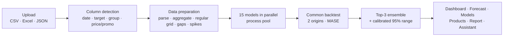

# DemandSense

**Demand forecasting for retail and operations teams.** Upload a sales or demand history (CSV, Excel or JSON), and DemandSense prepares the data, trains 15 forecasting models plus an ensemble, ranks them all on the same held-out backtest, and presents the winning forecast with a calibrated 95% range. A dashboard, model comparison, per-product drill-down, a written insights report and a forecast assistant sit on top.

Version `0.2.0` · Capstone project, PES University (Dept. of CSE) · Functionally complete; not production-hardened (see [Security](#security-and-deployment)).

---

## Contents

- [What it does](#what-it-does)
- [How it works](#how-it-works)
- [Quick start](#quick-start)
- [Configuration](#configuration)
- [Using the app](#using-the-app)
- [API reference](#api-reference)
- [Project structure](#project-structure)
- [Testing and benchmarks](#testing-and-benchmarks)
- [Results](#results)
- [Security and deployment](#security-and-deployment)
- [Limitations and roadmap](#limitations-and-roadmap)
- [Further documentation](#further-documentation)
- [Credits](#credits)

---

## What it does

**Forecasting**
- **15 models + a top-3 ensemble**, covering statistical, exponential-smoothing, decomposition, machine-learning, intermittent-demand and baseline methods ([full list](#models)).
- **Fair model selection:** every model is refit from the same forecast origins and scored on the same unseen windows. They're ranked by **MASE**, where below 1.0 means the model beats a seasonal-naive forecast.
- **Calibrated 95% ranges** built from each model's own backtest errors, clipped at zero for non-negative series.
- **External drivers:** detected price and promotion columns are fed to XGBoost, Random Forest and SARIMAX.
- **Holiday effects** for 15 countries (Prophet).
- **Per-product forecasts:** forecast any single store, product or category from the breakdown table.

**Data preparation you can trust** ([design](DATA_HEALTH_DESIGN.md))
- Number formats (`1,234.56` vs `1.234,56`) and day/month order are decided **for the whole column**, not value by value.
- Transaction-level files are totalled per period, and periods with no records count as **zero sales** instead of invented values.
- Readings (price, temperature, stock level) are averaged, never summed or zero-filled.
- Typo dates, extreme one-off spikes and daylight-saving repeats are handled, each with a warning. Real seasonal peaks are kept.
- Files that can't be forecast (no date column, no numeric column) are blocked with a clear reason.

**Workspace**
- Enterprise app shell: navy sidebar, top bar with live run status, light and dark themes.
- **Dashboard** with KPIs, actual-vs-forecast chart, a *Needs attention* panel, top models and products, and run details.
- **New forecast** in four steps: upload → map columns (with data preview) → run → review.
- **Model comparison** leaderboard, **Product breakdown**, **Forecast** table with CSV/JSON export.
- **Insights report:** a structured briefing (dataset overview, outlook, recommendations, trend signal, stock alerts) grounded in a 13-document retail knowledge base. Printable to PDF.
- **Assistant:** a docked side panel for questions about the current forecast, using the same knowledge base.

The report and Assistant use Google Gemini. Forecasting itself works without it.

---

## How it works



1. **Upload** (`POST /upload`) saves the file and detects the date, target, grouping and price/promo columns. It returns a 5-row preview, column profiles and validation errors.
2. **Preparation** (`services/preprocessor.py`) parses dates and numbers per column. It then aggregates rows per period (sum for amounts, mean for readings), puts the series on a regular calendar, fills gaps (zero for amounts, interpolation for readings), excludes isolated typo dates and replaces extreme spikes. Every change is recorded in a preparation report.
3. **Training** (`services/model_runner.py`) runs all models in a persistent process pool. Each model is fit on the full history and refit from 2 earlier cut-off points to forecast windows it hasn't seen. Training uses at most the most recent 2,000 observations.
4. **Selection** ranks models by MASE on those windows and averages the top 3 (excluding the seasonal-naive baseline) into an ensemble. The ensemble is scored on the same windows and only wins if its error is lower.
5. **Response:** the winner's forecast with its 95% range, the full leaderboard, the run details and the recent history (up to 365 points) for the chart.

### Models

| Family | Models |
|---|---|
| Statistical | ARIMA, SARIMA, SARIMAX |
| Exponential smoothing | Holt-Winters, Exponential Smoothing, AutoETS, Theta |
| Decomposition | MSTL, Prophet |
| Machine learning | XGBoost, Random Forest, SVM |
| Intermittent demand | Croston (SBA) |
| Baselines | Moving Average, Seasonal Naive |
| Combination | Ensemble (equal-weight mean of the top 3) |

Why these and not deep learning: see [MODEL_UPDATES.md](MODEL_UPDATES.md). The deep-learning models were all worse than the seasonal-naive baseline on held-out data and were removed in v0.2.

---

## Quick start

### Prerequisites

- **Python 3.11+** (developed on 3.14)
- **Node.js 18+** and npm
- **macOS only:** XGBoost needs the OpenMP runtime: `brew install libomp`
- A **Google Gemini API key**, only for the Insights report and Assistant

### Backend

```bash
cd backend
```

```bash
python3 -m venv venv && source venv/bin/activate
```

```bash
pip install -r requirements.txt
```

```bash
cp .env.example .env    # then set GEMINI_API_KEY
```

```bash
uvicorn main:app --host 127.0.0.1 --port 8000 --reload
```

Check it's up: `GET http://127.0.0.1:8000/health` returns `{"status": "ok", "service": "retail-forecasting-backend"}`. Worker processes warm up in the background on start, so the first forecast isn't slowed by model imports.

### Frontend

```bash
cd frontend
```

```bash
npm install
```

```bash
npm run dev
```

Open <http://127.0.0.1:5173>. The frontend calls `http://127.0.0.1:8000` unless `VITE_API_BASE_URL` is set.

No database or model download is needed. `uploads/`, `processed/`, `session_data/` and `.chroma/` are created on first use.

---

## Configuration

| Variable | Where | Required | Purpose |
|---|---|---|---|
| `GEMINI_API_KEY` | `backend/.env` | For report and Assistant | Gemini chat/report generation (`gemini-flash-latest`) and knowledge-base embeddings (`gemini-embedding-001`). Without a valid key, forecasting works normally; the report and Assistant show a notice instead of written analysis. |
| `ALLOWED_ORIGINS` | backend environment | In production | Extra CORS origins, comma-separated. Local dev origins are always allowed. |
| `FORECAST_USE_PROCESSES` | backend environment | No | `0` runs models in threads instead of worker processes (for environments that can't spawn processes). Default `1`. |
| `VITE_API_BASE_URL` | `frontend/.env` | In production | URL of the deployed backend. |

---

## Using the app

1. **Dashboard:** opens empty until the first forecast. Click **New forecast**.
2. **Upload data:** drag in a CSV, XLSX/XLSM (first sheet) or JSON file with one row per date, or per date and product/store.
3. **Map columns:** check the detected date column and value to forecast, set the horizon (1–365 periods), and optionally choose a *Group by* column and a holiday calendar. Data checks and a 5-row preview are shown here.
4. **Run:** typically 15–90 seconds. You can leave the page; the top bar shows progress.
5. **Review:** open the dashboard, the forecast (export CSV/JSON), the model comparison, or the product breakdown, where **Forecast** on any row trains models for that product alone.
6. **Insights report** and **Assistant** (top bar) explain the result in plain language.

Theme (light, dark, match system) is under the account menu or **Settings**, which also shows whether the forecasting service is reachable.

---

## API reference

All endpoints take and return JSON, except `/upload`, which takes `multipart/form-data`. There's no authentication (see [Security](#security-and-deployment)). Interactive docs: <http://127.0.0.1:8000/docs>.

| Method | Path | Purpose |
|---|---|---|
| `POST` | `/upload` | Save a file; return detected columns, preview, suggestions, validation |
| `POST` | `/forecast` | Prepare data, run all models, return leaderboard + forecast |
| `GET` | `/forecast/latest?session_id=` | Last forecast for a session |
| `POST` | `/forecast/product-summary` | Ranked per-group totals with trend labels (no model training) |
| `POST` | `/api/insights/generate` | Generate the insights report |
| `GET` | `/api/insights/async_report_status?filename=` | Poll for the fuller background report |
| `POST` | `/api/chat/ask` | Ask the Assistant about a forecast |
| `GET` | `/api/chat/history/{session_id}` | Conversation history |
| `POST` | `/api/chat/reset/{session_id}` | Clear history, keep forecast context |
| `DELETE` | `/api/chat/session/{session_id}` | Delete a conversation |
| `GET` | `/health` | Liveness check |

### `POST /upload`

Response (abridged):

```json
{
  "file": {"filename": "sales.csv", "saved_as": "3f2a…_sales.csv", "size_bytes": 48213},
  "shape": {"rows": 10965, "cols": 6},
  "preview": [{"Date": "2024-01-01", "Store": "North", "Units_Sold": 104, "Price": 12, "Promo": 0}],
  "detected": {
    "date_columns": ["Date"],
    "numeric_columns": ["Units_Sold", "Price", "Promo"],
    "grouping_columns": ["Store", "Product"],
    "exog_columns": {"price_cols": ["Price"], "promo_cols": ["Promo"]}
  },
  "suggestions": {"date_col": "Date", "target_col": "Units_Sold", "frequency": "daily"},
  "validation": {"is_valid": true, "errors": [], "warnings": []}
}
```

### `POST /forecast`

Request:

```json
{
  "filename": "3f2a…_sales.csv",
  "date_col": "Date",
  "target_col": "Units_Sold",
  "forecast_horizon": 30,
  "feature_cols": ["Price", "Promo"],
  "country": "IN",
  "session_id": "b7e1…"
}
```

Use `target_cols: [...]` instead of `target_col` to forecast several columns independently in one call. Add `group_col` + `group_value` to forecast one product or store.

Response (abridged):

```json
{
  "target_col": "Units_Sold",
  "best_model": {
    "best_model_name": "AutoETS", "mase": 0.815, "rmse": 66.9, "mae": 52.9, "mape": 0.028,
    "evaluation": "holdout_backtest", "interval_method": "backtest_calibrated",
    "forecast": [1890.2, "…"], "forecast_lower": [1851.0, "…"], "forecast_upper": [1928.4, "…"],
    "ensemble_members": ["AutoETS", "MSTL", "SARIMAX"]
  },
  "all_models": [{"model_name": "AutoETS", "status": "success", "mase": 0.815, "train_time_sec": 0.78}, "…"],
  "forecast_dates": ["2026-01-01", "…"],
  "historical": {"dates": ["…"], "values": ["…"]},
  "model_run_info": {
    "evaluation": "holdout_backtest", "backtest_origins": 2, "backtest_horizon": 30,
    "frequency_tier": "daily", "seasonal_period": 7, "models_run": 15,
    "row_count": 731, "original_row_count": 731, "training_window_truncated": false
  },
  "exog_features_used": ["Price", "Promo"],
  "group": null
}
```

`all_models[].internal_cv` holds each model's own cross-validation metrics. They are **not** comparable across models and are not used for ranking.

---

## Project structure

```
DemandSenceAi/
├── backend/
│   ├── main.py                  FastAPI app, CORS, routers, /health, worker warm-up
│   ├── routers/                 upload · forecast · insights · chat
│   ├── services/
│   │   ├── preprocessor.py      Parsing, aggregation, calendar, gaps, spikes, preparation report
│   │   ├── model_runner.py      Model registry, process pool, common backtest, MASE, ensemble, intervals
│   │   ├── best_model.py        Winner selection and usability checks
│   │   ├── product_analytics.py Per-group totals and trend labels
│   │   ├── insights_service.py  Insights report (deterministic overview + stockout scan + Gemini)
│   │   ├── explainer.py         Assistant context and chat sessions
│   │   ├── rag_service.py       ChromaDB retrieval over knowledge_base/
│   │   ├── llm_retry.py         Retry/backoff for transient Gemini errors
│   │   └── session_store.py     Per-session forecast and chat persistence
│   ├── models/                  One file per model family
│   ├── knowledge_base/          13 retail-planning documents (report/Assistant grounding)
│   ├── benchmarks/
│   │   ├── selection_benchmark.py, m5_ingest.py   Model-selection study (paper)
│   │   └── data_health/         Fault probes, accuracy impact, 18-shape generalisation check
│   └── tests/                   pytest suite
├── frontend/
│   └── src/
│       ├── App.jsx, main.jsx    Shell, routing (hash-based), providers
│       ├── pages/               Dashboard · NewForecast · Forecast · Models · Products · Report · Settings
│       ├── components/          shell/ (Sidebar, TopBar, PageHeader), ui.jsx kit, ForecastChart,
│       │                        Stepper, AssistantPanel, Markdown
│       ├── state/AppState.jsx   Upload → mapping → run → results workflow state
│       ├── lib/                 theme, router, formatting, dashboard insights
│       └── index.css            Design tokens (light/dark)
├── research/                    IEEE-format paper on the model-selection study
├── DATA_HEALTH_DESIGN.md        Data-quality architecture and evidence
└── MODEL_UPDATES.md             v0.2 model changes and benchmark
```

---

## Testing and benchmarks

Run these from `backend/` with the virtualenv active.

```bash
python -m pytest -m "not slow"     # fast suite (167 tests)
```

```bash
python -m pytest -m slow           # trains real models (2 tests)
```

| Script | What it shows |
|---|---|
| `benchmarks/data_health/parse_probes.py` | How specific data faults are handled (number formats, date order, typo dates, duplicates, peaks) |
| `benchmarks/data_health/generalization.py` | 18 dataset shapes: clean ones must come out unchanged with no warnings |
| `benchmarks/data_health/fault_impact.py` | End-to-end forecast accuracy per fault, as handled vs correctly handled (~5 min) |
| `benchmarks/data_health/seasonal_blind_spot.py` | Per-model December forecasts: why recent-window backtests miss seasonal events |
| `benchmarks/selection_benchmark.py` | The model-selection study behind the paper |

Frontend: `npm run build` in `frontend/`.

---

## Results

**Model selection (v0.2).** 10 series (5 real uploads, 5 synthetic), last 28 points held out (13 for short series):

| Selection policy | Geo-mean MASE (lower is better) |
|---|---|
| Common backtest + ensemble (current) | **0.765** |
| Lowest internal-CV RMSE (v0.1 rule), same models | 0.862 |
| Seasonal naive | 1.169 |

A 731-row daily series takes about 20 s end to end, down from about 100 s, because models now run in processes rather than GIL-bound threads.

**Data preparation (phase 1).** All 10 clean dataset shapes in the generalisation check come out unchanged with zero warnings. The previously silent faults found in testing are fixed, including US thousands separators read as decimals (1000× errors), day-first monthly dates collapsing into one month, typo dates inventing thousands of days, and real seasonal peaks being capped. Accuracy on clean data is unchanged (MASE 0.68). Details and remaining gaps: [DATA_HEALTH_DESIGN.md](DATA_HEALTH_DESIGN.md).

---

## Security and deployment

Suitable for local or single-tenant use. Before any shared or public deployment:

- **No authentication or rate limiting.** Every endpoint is open, including the Gemini-backed ones that consume API quota. `session_id` is a cache key, not a credential (it is validated before use in file paths).
- **Uploaded files are publicly readable.** `main.py` mounts `backend/uploads/` at `/uploads` as static files. Remove the mount or put it behind auth before deploying.
- **CORS** allows all methods and headers for the configured origins.
- **No TLS** at the app level. Terminate HTTPS at a reverse proxy.
- **Long requests:** a forecast is one synchronous request (seconds to a couple of minutes), so this isn't suited to serverless timeouts. Use a long-running host.
- **Persistent disk** is needed for `uploads/`, `processed/`, `session_data/` and `.chroma/`.
- **Single instance:** session caches are per process.
- No Dockerfile or CI configuration is included yet.

---

## Limitations and roadmap

Current limitations:
- Data comes from files only (CSV, Excel first sheet, JSON); no database connectors.
- Whether a column is an amount (summed) or a reading (averaged) is inferred from its name.
- Some data questions are genuinely ambiguous (a missing week: closure or export outage?). Today they get a default and a warning in the preparation report, but **these warnings are not yet shown in the UI**.
- Model selection scores recent windows only, so a seasonal event inside the horizon (e.g. December) can be missed even when a model captures it.
- There's no "flat average" baseline or confidence grade yet, so a forecast on unpredictable data isn't flagged as such.
- Stock alerts are a pattern scan of sales history, not real inventory data. The trend signal is revenue-based, not margin.
- No hierarchical reconciliation (store → region → total). Hyperparameters for XGBoost and Random Forest are fixed.

Roadmap ([DATA_HEALTH_DESIGN.md §6](DATA_HEALTH_DESIGN.md#6-delivery-plan)):

| Phase | Scope | Status |
|---|---|---|
| 1 | Stop silent data corruption | Done |
| 2 | Show the preparation report and findings in the UI ("What we changed") | Next |
| 3 | Data profile, detectors, materiality-gated questions for ambiguous data | Planned |
| 4 | Seasonal backtest origin, flat-average baseline, forecast confidence grade | Planned |
| 5 | Data-health benchmark in CI | Planned |

Beyond that: authentication and rate limiting, a task queue for long runs, a shared session store, Docker and CI.

---

## Further documentation

- [DATA_HEALTH_DESIGN.md](DATA_HEALTH_DESIGN.md): data-quality architecture, reproduced faults, measured impact, phased plan.
- [MODEL_UPDATES.md](MODEL_UPDATES.md): what changed in the v0.2 model set and why.
- [research/](research/): IEEE-format paper, *Cost Belongs in the Constraint, Not the Objective: A Held-Out Evaluation of Multi-Criteria Model Selection for Retail Demand Forecasting*.

---

## Credits

Capstone project, Department of Computer Science and Engineering, PES University, Bengaluru.
Authors: Ranjith Kumar N, Pooja Ammalajeri, Gayathri M, Preetham Kumar S. Guide: Dr. Jyothi R.
